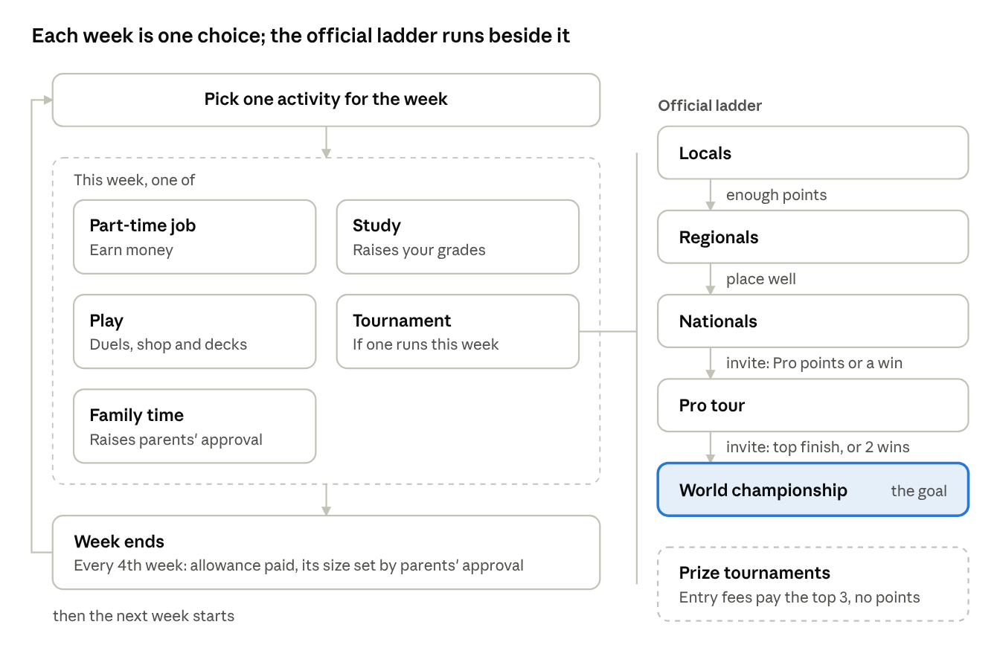
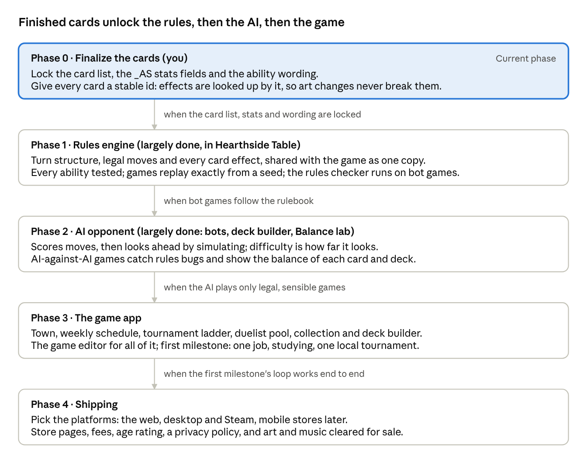

> Copied from the claude.ai doc https://claude.ai/artifact/JK9phT49rY1d2oK4riPSDp on 2026-11-01 (the original is in `originals/adventure-scuffle-roadmap.docx`). The doc may be newer than this copy.

# Adventure Scuffle: game roadmap

Oct 23, 2026 · @Hanielle Marie Armas

## Context

The goal is a separate game app for Adventure Scuffle only, in the style of the Yu-Gi-Oh! GX games. Work starts once the cards are final; until then this is a roadmap, and each phase gets its own detailed plan when it begins.

Most of the game is the card game, the tournaments and a weekly schedule. Today the cards are designed in Hearthside Cardworks and played by hand on Hearthside Table, which now enforces the full rules, with bots, tournaments and the Balance lab.

**What the game has:**

- a town menu on an illustrated map, with an illustrated scene for each location

- NPC opponents to duel, each with their own deck and personality

- tournaments

- a card collection, with deck building from the cards you own

**Decisions already made:**

- The game is for Adventure Scuffle only, not a tool for any game.

- It is built **on the same web stack as Cardworks and Hearthside Table** (React and TypeScript), and ships the same ways: desktop, Android and the web. You edit its content in a game editor that I build; code is my part. Not Godot: it would mean rewriting the rules and AI and keeping two copies in step.

- The rules and card effects are the existing engine, shared with Hearthside Table, so a card change shows up in the playtest app, the Balance lab and the game at once. It is not a general blocks or scripts system.

- **The scope is small:** one town, a weekly schedule, tournaments and the card game. There is no open world.

- Nothing is built until the cards are final.

## The game at a glance

the weekly loop and the tournament ladder

It plays like Monster Rancher 2 in 2D: a home hub, a town menu, one choice a week and a calendar of what is coming. Every week costs one choice, so money, your parents' mood and tournament play pull against each other. A tournament week enters whatever your rank allows: the official ladder for points and invitations, or unofficial events for packs and money.

## What the game needs

The game has eight parts. The card game, the AI and the tournaments already exist; the rest is built for this game.

**Town**

- The town is a menu, shown on an illustrated town map that you draw: home (save and plan the week), the card shop, the park, the tournament hall, and the job sites. You pick a place from the menu; there is no walking around.

- Each location opens a static scene with your own illustration as the background, and paper-doll characters standing in it. Click a character to talk.

- Fewer than 10 characters you can talk to. Who is where can change by week, season or your rank (the rival at the park after a big win, for example). Background characters stand in a scene and at most say one line.

- Small touches: the season shown on the map, a marker on locations with something new, and the season's watch list posted at the card shop.

**Weekly schedule (the core loop)**

- Each week you pick one activity: a part-time job, studying, family time with your parents, playing (practice duels, the shop, deck building) or a tournament on that week. There is no planner: you plan ahead yourself, from the calendar of upcoming events.

- Part-time jobs (helping at a store, mowing lawns, babysitting) each show a static picture or a short animation and pay money.

- Studying raises your study rating (your grades) and your parents' approval. The higher their approval, the bigger the monthly allowance; low approval means a smaller one.

- Family time raises your parents' approval. Going many weeks without it lowers approval.

- The monthly allowance is the main source of income, and your parents' approval sets its size. Part-time jobs, prize tournaments and selling rare cards add to it.

**Exam weeks**

- There is one exam week per season, 4 a year. Each one lands on the week of an important tournament: in seasons 1 to 3 the game picks a regionals, Nationals or Pro Tour week of that season at random, and in season 4 the exam is always on the week of the season 4 Nationals, the last chance for Worlds.

- Going into an exam week without a good study rating and good parents' approval means you are grounded: you can't enter that week's tournament and must study instead.

- With both high enough, you choose: study for the exam, or play the tournament.

- Exam results feed back into your study rating and your parents' approval.

- Outside exam weeks too: low school performance lowers your parents' approval every week, and if it falls too low you are grounded. Grounding blocks some activities (tournaments first) until your grades recover.

**Spending money**

- **Cards:** booster packs, and singles (individual cards) at the card shop.

- **Study aids** (a study guide, a tutor session): you gain study rating that week even while working a job or playing.

- **Gifts for your parents** (flowers, helping with chores, a nice dinner): they raise parents' approval.

- Each item has a price and an effect, set in the shop editor, so more can be added later.

**Tournaments**

- The official ladder: locals, regionals, nationals, pro tour, world championship.

- Each step has its own way in (see the calendar below). Pro Tours and Worlds are by invitation only, and Worlds is the end goal.

- Prize tournaments give no ranking points. Each one sets its own size, format and entry fee, and the entry fees make up the prize pool for the top 3; a higher fee means a much bigger pool. The pool splits 50% to 1st, 30% to 2nd and 20% to 3rd. There are two kinds:

- **Community tournaments**, held in a public place such as the park: all of the entry fees go to the prize pool.

- **Shop-run or promotional tournaments**: the organizer keeps 20% of the entry fees, and the other 80% is the prize pool.

- Official tournaments are free to enter and award points and invitations. Nationals, Pro Tours and Worlds also pay cash prizes to their top finishers, growing with each step: a Nationals prize buys a few boosters or a helpful item, a Pro Tour prize buys more, and Worlds pays the most.

- A season lasts 3 months, so a year of 4 seasons is 12 months. Official tournaments run on fixed weeks (the calendar below). Prize tournaments are not always known far ahead: some are announced a month before, some only a week before, and they appear on the calendar when announced. Official ones are fixed and on the calendar all year.

- **The ending:** winning a World Championship ends the game with its happy ending: the prize money covers your education and your parents are proud of you. Otherwise the seasons carry on, for at most 7 years: a year is 4 seasons and ends with the World Championship, so you get 7 tries. If the 7th year ends without a win, the game ends there.

- **The ban list:** two updates a year, with a watch list first and a grace period, so no deck dies overnight; banned cards come back after a year. See Ban list below.

- Venues are static screens: the background, the entrants, the bracket, the duels and the results. One template serves every venue.

- **Spectating,** as in Monster Rancher 2: from the bracket you can pick any other match of the round to watch. That match is played out as a real AI-against-AI duel instead of the quick calculation, with speed controls (1×, 2×, 4×) and a skip-to-result button. Matches you don't watch are still settled instantly.

**Ban list**

Bans are rare, announced ahead and never land mid-event, and a banned card comes back after a year.

- **Two updates a year**, at the start of seasons 1 and 3: season 1 right after the World Championship, season 3 together with the new cards.

- **Watch list first:** at the start of every season the game posts 1 to 3 watched cards (in-game news, a poster at the card shop, NPCs talking about them), the most-played cards in the previous season's top official decks. Only a card watched the season before can be banned.

- **Small bans:** at most 2 cards per update. A watched card is banned only if it is still in more than a set share of top decks (40% to start, set in the tournament editor), never 2 from the same family in one update, and never in its first 2 seasons out.

- **Grace period:** a ban is announced 4 weeks ahead and shown on the calendar, never takes effect during a tournament you've entered, and the deck builder marks the decks it affects.

- **No feel-bad losses:** the card shop buys a banned card back at full price, or you keep it for its return. A deck with a banned card still works in practice duels and in prize tournaments that don't use the ban list (an option in the tournament editor); official events always use it.

- **Unbans:** a banned card serves at least 4 seasons. At each update, 1 card that has served its time comes back, picked at random. If bans pass 10% of the legal pool, extra cards come back. A returned card can't be banned again for 2 seasons.

- **NPCs:** they swap banned cards for replacements, and some move off watched cards early.

|                             | Year 1       | Year 2 | Year 3 | Years 4 to 7  |
| --------------------------- | ------------ | ------ | ------ | ------------- |
| Ban updates                 | 1 (season 3) | 2      | 2      | 2 a year      |
| New bans, at most           | 2            | 4      | 4      | 4 a year      |
| Unbans, at most             | 0            | 1      | 2      | 2 a year      |
| Banned at year end, at most | 2            | 5      | 7      | 9, 11, 13, 15 |

At most 15 cards are banned by year 7, about 7% of some 200 released; a typical game bans about half that.

**The official calendar**

| Tournament         | When                                | Per year | How you get in                                                                                                               |
| ------------------ | ----------------------------------- | -------- | ---------------------------------------------------------------------------------------------------------------------------- |
| Locals             | Every week, like Friday Night Magic | About 52 | Open to anyone                                                                                                               |
| Regionals          | The first week of every month       | 12       | Enough points from locals                                                                                                    |
| Nationals          | Week 3 of seasons 2 and 4           | 2        | Placing well at regionals                                                                                                    |
| Pro Tour           | The last week of seasons 1, 2 and 3 | 3        | Invitation: enough Pro points from regionals and Nationals, or winning a Nationals (an instant invite)                       |
| World Championship | The last week of season 4           | 1        | Invitation: doing well at a Pro Tour, winning 2 Nationals within the last 2 years, or winning that year's season 4 Nationals |

**Nationals is a big deal.** Ideas to make it feel that way:

- its own grand venue scene, with a crowd and an announcer

- posters on the town map in the weeks before it, and characters talking about it

- a trophy and the title "National Champion", which NPCs mention afterwards

- a story moment with the rival at every Nationals

- a special prize for the winner on top of the Pro Tour invite (for example, a unique foil)

**The season 4 Nationals is the last chance for Worlds.** Its winner goes straight to that year's World Championship instead of a Pro Tour. Because of that, its field is tougher: Pro Tour and Worlds-level duelists who haven't qualified yet enter it too, alongside the regionals qualifiers.

**Official tournament formats**

| Tournament         | Players | Format                                                                                           | Match length                      | Your matches, at most |
| ------------------ | ------- | ------------------------------------------------------------------------------------------------ | --------------------------------- | --------------------- |
| Locals             | 8       | Round robin                                                                                      | Best of 1                         | 7                     |
| Regionals          | 16      | 3 rounds of Swiss, then a top 4 single-elimination cut                                           | Best of 1                         | 5                     |
| Nationals          | 32      | 5 rounds of Swiss, then a top 8 single-elimination cut                                           | Best of 1                         | 8                     |
| Pro Tour           | 16      | 4 groups of 4, round robin; each group winner goes to a 4-player single-elimination bracket      | Best of 3; the final is best of 5 | 5                     |
| World Championship | 16      | 2 groups of 8, round robin; the top 4 of each group go to an 8-player single-elimination bracket | Best of 3; the final is best of 5 | 10                    |

Prize tournaments are best of 1 too.

Only your own duels are played out; the other entrants' matches are simulated quickly by the AI to fill the standings.

**Opponents**

- A pool of duelists in difficulty tiers, each with a portrait, a sprite, a deck, a tier (which sets the AI level), a play style, and intro, win and loss lines.

- Official tournaments take the duelists who qualified; prize tournaments draw entrants from the pool by tier.

- A rival who climbs the ranks alongside you, matching your best result, and always has a strong deck.

- When a ban list changes, NPC decks that hold a banned card swap it for a replacement the AI picks, so every duelist stays legal.

**Light story**

- The rival, and town characters whose lines change as your rank and your parents' mood change.

- The goal is winning the world championship.

**Cards and collection**

- Cards come in from Cardworks packs: pictures, stats, and a stable id per card.

- **The card pool grows:** every game starts with 60 cards: all 45 The First Quest cards, which are always there, plus 15 drawn from the rest. After that, 6 new cards come out every season from season 3 of year 1, drawn from the cards not out yet. Over 7 years (28 seasons) that is 60 + 26 × 6 = 216 cards, the new target (see Card pool size and releases below). Bans follow the Ban list rules under Tournaments. The draws are random-ish, so every game has its own starting cards and release order, seeded per save. By year 7 every game holds all 216 cards; what differs is the order they arrived in and the ban lists, which follow what was played in that save. Packs, the shop and NPC decks only use cards that are out.

**Random-ish, proposed rules:** at most 1 Ace among the 15 extra starting cards and at most 1 per release; no family card arrives alone (another card of its family comes in the same draw or the next one, so bonds have a partner); families stay at 6 or fewer; and a new deck's new mechanic arrives with at least 2 cards that use it.

- Because the pool is random, NPC decks are built by the game from the cards that are out, following each duelist's play style and tier, instead of being fixed lists. They rebuild each year when new cards come out.

- Card packs of 3 cards, and a pack-opening screen. There are two rarities: common, and rare, which is a foil version of a normal card. Rares can be sold to card shops, collectors and other NPC players.

- A deck builder in the Yu-Gi-Oh! style: your collection as a grid with filters, a deck list beside it, a rule check (deck rules and the current ban list), and several saved decks.

**Card battles**

- The rules and every card's effect: the existing engine from Hearthside Table.

- The AI, which also sets each NPC's difficulty.

- The duel screen with its animations.

**The game editor (your no-code tools, a separate app beside Cardworks and Hearthside Table)**

| Tool                       | What you set in it                                                                                                             |
| -------------------------- | ------------------------------------------------------------------------------------------------------------------------------ |
| Town NPC editor            | Put a character in a location, on chosen weeks; their dialogue and role (shop, collector who buys rares, rival, hints)         |
| Duelist pool editor        | Portrait, deck style (the kind of deck the game builds them), tier, play style, lines                                          |
| Tournament editor          | Official, community or shop-run; tier, weeks, size, format and match length; entry fee and prize split, or points; entry rules |
| Calendar and events editor | When each prize tournament is announced (a month or a week ahead) and when it runs; story moments and other dated events       |
| Job and activity editor    | Pay, the picture or animation, the effect on your parents' mood                                                                |
| Shop editor                | Packs (which cards, rarities, price), singles prices, and items with their price and effect                                    |
| Cardworks pack importer    | Brings new or changed cards into the game                                                                                      |
| Dialogue editor            | Conversations, portraits and choices                                                                                           |
| Location editor            | A location's background, its spot on the town map, and where characters stand                                                  |

**Also needed, all small:** save slots; settings (volume, text speed, controls); music and sound; a short tutorial in the first duels; a debug menu (jump to any week, give money or cards, start any duel); AI-against-AI balance reports.

## NPC duelists: decks and careers

The game builds every NPC's deck itself and keeps a career record for each duelist, so the same faces climb the ladder with you.

**How decks are built** (once a year, when new cards come out, on a "new season" screen)

1.  **A first draft:** every card gets a score from its stats and abilities, plus how well it works with the cards already picked. The builder adds the best card, then the next, until it has 12 (one copy each, at most one Ace, nothing banned).

2.  **Testing in play:** it swaps a card or two and plays fast AI-against-AI games, keeping a swap when the deck wins more. A few hundred quick games settle on a strong deck.

**Weaker decks on purpose**

- Lower tiers stop early: the first-draft deck, or a random pick among the top few choices.

- Low-tier duelists own only part of the pool, as the player does.

- Personalities can force in favourite cards that aren't the strongest.

- Play skill is separate: the same deck plays weaker under an easy AI.

- "Optimal" means best against the game's own AI; a clever player may still find a better deck.

**Careers: a living player pool**

- Every duelist in the pool keeps ranking points, results and qualifications, just like the player.

- The game plays out the whole official ladder each season, including the tournaments you skip, so duelists earn their places in regionals, nationals, Pro Tours and Worlds.

- That is why opponents from your regionals or nationals can turn up at a Pro Tour or the World Championship.

- Duelists move up or down a tier with their results, and their collections grow over the years.

- **The rival** always sits at the level of your best result so far: when you reach a new stage of the ladder, they do too, and if you qualify for Worlds, so do they.

- Balance reports from these simulated seasons show which cards the AI keeps picking: the likely candidates for being too strong.

**Pool size: about 120 duelists.** Nationals is roughly the top quarter of active players, so 32 places suggest a scene of about 120:

| Group                    | About    | Where you meet them                      |
| ------------------------ | -------- | ---------------------------------------- |
| Your town's locals scene | 15 to 20 | Weekly locals; the same faces every week |
| Players from other towns | 60 to 70 | Regionals and up                         |
| The elite                | 25       | Nationals and Pro Tours                  |
| International players    | 10       | Only at the World Championship           |

Only the rival and 10 to 15 regulars are hand-made; the rest are generated from paper-doll parts. Matches between NPCs are settled by a quick calculation from skill, deck strength and some luck, and full duels are played only when you are in them or choose to watch, so a whole season simulates in a second or two.

## Characters: paper dolls

Every character in the game, the player included, is a static paper doll: layered parts stacked into one picture, with no frame-by-frame animation.

- **Parts you draw,** all on one canvas size and pose: bodies, faces (eyes, brows, mouths), hairstyles, outfits and accessories. Each part is drawn once, and a palette shader gives it any colour.

- **No movement needed:** characters stand in location scenes and slide in or out when they arrive or leave. Expressions in dialogue swap the eye and mouth parts.

- **Generated duelists:** a new game builds random duelists from the parts, with names from name lists and a random personality, deck style and starting tier. They are saved with that game, so the same people recur across its seasons.

- **Preset characters** (the rival, the town NPCs, memorable regulars) are made by you and appear in every game.

- **Your own character:** a new game opens the character maker for the player, who picks parts and colours and types a name. Dialogue uses that name.

- **Your tool:** a character maker in the game editor. You click through parts and colours, re-roll random people to check the mixes, rule out clashing combinations (a hat over a tall hairstyle) and save presets. The new-game screen uses the same maker, limited to what players may pick.

- **Colours from one drawing:** each part is drawn once in greyscale (shading only) and coloured by a gradient map: the greys are mapped onto a ramp of colours, so shading and line work stay clean. Hue, saturation, brightness and contrast can also be adjusted; only the settings are saved, never a changed copy of the drawing.

- **Skin tones:** 8 to 12 preset ramps from very light to very dark, each of 3 to 5 colours (shadow, base, light, highlight). Shadows get warmer, not just darker, and each ramp sets its own contrast (darker tones often want stronger highlights and softer shadows). Hair, eyes and outfits work the same way.

- **Drawing tips:** shade in the mid-greys, avoiding near-white and near-black except small highlights and the deepest shadows; keep lips, blush, freckles and line art on their own layers with their own colours; draw areas that take different colours (a shirt and its trim) as separate layers or masks.

- **In Cardworks today:** only greyscale (grey icons, draft printing). Hue and contrast controls for images would be a later Cardworks feature.

## Story

The game has two layers of story: the player's own world, and the lore inside the card game they play.

- **The game's world:** the player's town, school and family. Adventure Scuffle! is a popular card game there, launched a year and a half before the game starts. It is based on a hit TV anime and video game series about Misha the Unassuming Mage, so its factions, characters and sets come from the show. The rival and the town characters live in this world.

- **The card game's lore:** the world of the anime, set in the Yfera timeline in the Age of Magic, before Yfera awakens. The First Quest centres on the border town of Rotos: the Adventurer's Guild and the Rianz Church's hero hunt the Necromancer, who is really the town's protector against the Banded Horde, while Misha quietly resolves it all and fights the incursions behind it. The 9 new decks come from new regions of the Age of Magic; you write their lore.

- **Full card game lore** and its gaps live in the Card game lore tab of [Adventure Scuffle: 216-card design](https://claude.ai/artifact/5RABFS9wYg643nJhekYD62).

## What carries over

The hardest parts of the game already exist in Hearthside Table and are used as they are, with no rewrite. The game and the playtest app share one copy of the rules, so they never drift apart.

| Already built                                                           | Where                                         | What the game uses it for                                           |
| ----------------------------------------------------------------------- | --------------------------------------------- | ------------------------------------------------------------------- |
| The rules engine and every card ability                                 | src/adventure                                 | Duels, with every rule enforced                                     |
| Bots at three levels, plus a fast quick bot                             | src/adventure/bot                             | NPC opponents and their difficulty; simulated matches               |
| The deck auto-builder (Suboptimal and Optimal)                          | src/adventure                                 | NPC decks, rebuilt each year from the cards that are out            |
| Tournament formats: round robin, Swiss, groups, knockout, match lengths | src/playtest-app/tournament                   | Every official and prize tournament                                 |
| Replays and the rules checker                                           | src/adventure, src/playtest-app               | Spectating, saved duels, catching rule bugs                         |
| The Balance lab                                                         | src/adventure/lab                             | AI-against-AI balance reports and ban-list checks                   |
| Game packs: card pictures plus stats by field name                      | src/playtest/pack.ts, exported from Cardworks | Getting cards into the game: keep designing in Cardworks and export |
| Storage, autosave and backups; desktop, Android and web builds          | src/storage, electron, android                | Save slots, and shipping on each platform                           |

## The bots: MCTS plan

The next bot work is MCTS (Monte Carlo tree search), as agreed: first a way to measure the bots, then MCTS, then tuning on your PC, and later light self-play. It is the groundwork every duel and every NPC in the game stands on.

**Where the bots stand**

| Bot    | How it decides                                                                             | Used by                                                                            |
| ------ | ------------------------------------------------------------------------------------------ | ---------------------------------------------------------------------------------- |
| Quick  | Fixed rules of thumb                                                                       | Balance lab Quick runs, the deck auto-builder's card values, Hard's practice games |
| Normal | Quick, plus a one-step look ahead for abilities and choices                                | The table, tournaments, Normal lab runs                                            |
| Hard   | Normal, plus about 100 practice games for each Fighting Spirit and First Engagement choice | The table                                                                          |

None of them peek: they guess the opponent's hidden cards and never read them.

**Gaps found in the code**

- Revealing is random for every level: Normal and Hard leave the reveal step to Quick.

- Placement follows one fixed rule that ignores the opponent's board, and the bots always take the initiative.

- Quick always uses an ability whose text mentions "opponent" and others only 30% of the time. That bias reaches the Balance lab, the Optimal decks (so every NPC deck later) and Hard's practice games.

- Bot strength isn't measured: the tests only check that Normal and Hard beat Easy.

**The order**

1.  A bot ladder: every level plays every other on fixed decks and gets a rating, so each change has to prove it helps. Done in v0.2.0-alpha.1: the Balance lab's Bot ladder mode.

2.  MCTS for hidden cards (Information Set MCTS): it searches every decision (placement, reveal, abilities, choices, Fighting Spirit, the First Engagement, the initiative), with a time limit per move so it stays quick on a phone. The Quick bias is fixed in its practice games. Done in v0.2.0-alpha.1: it is the new Hard, with a thinking-time setting (0.5–4 s), and the reveal-size test rule (classic, pairs, triples) came with it.

3.  Tuning on your PC (Ryzen 7 5700X, all but one of its 16 threads): long ladders of MCTS against Hard, from the command line or the lab; you send the summary file and I set the defaults.

4.  MCTS becomes the top level and a lab option for checking shortlists. Difficulty tiers and personalities become MCTS settings: thinking time and practice games for skill, scoring weights for aggressive or defensive play.

5.  The quick result for NPC-against-NPC matches, tuned against MCTS games.

6.  Later, light self-play: a small "how good is this position" model trained from MCTS games, on your graphics card through WebGPU in the desktop app.

**Levels, decided:** with MCTS, Easy becomes today's Normal, Normal becomes today's Hard, and Hard becomes MCTS; today's random Easy is retired. The renaming ships with MCTS (version 0.2.0-alpha.1), so Hard is never empty. The Balance lab keeps naming bots by how they work (Quick, Tricks, Search), so earlier results stay comparable. Later every level can be MCTS with different settings (thinking time, guesses, a mistake rate), and tournament NPCs get play styles from scoring weights and preferred decks from the deck builder.

After step 2, run the Balance lab again (TFQ only, and a long Normal run): the results and the Optimal decks will shift.

## Card pool size and releases

Decided: the pool goes up to 216 cards (divisible by 9), because it fits seasonal releases exactly: 60 to start, plus 6 new cards every season from season 3 to the end of year 7 (26 releases). Today there are 102 cards, 8 of them Aces, and 1,029,881,347,536,769 possible legal decks.

| Target | Sheets of 9 | New cards to design | Fits 6 a season?                  |
| ------ | ----------- | ------------------- | --------------------------------- |
| 207    | 23          | 105                 | Runs out in year 7, season 3      |
| 216    | 24          | 114                 | Exactly, through the last season  |
| 225    | 25          | 123                 | 9 spare, to vary each game's pool |

**Reprint rule:** the same ability on the same card type appears on at most 3 cards, and at most 2 when it looks powerful. The 102 cards have 100 distinct abilities; the only reprints are Ambush: +1 FS (Duskfang Dagger, Whispering Silence; counted as powerful) and Final Blow: +1 FS (Dawnbreaker, Whispering Dread), 2 each.

**Suggested mix for 114 new cards** (keeping the pool's shape; Aces counted within the types):

| Type     | Now | New     | At 216   |
| -------- | --- | ------- | -------- |
| Battle   | 31  | 35      | 66       |
| Field    | 21  | 23      | 44       |
| Inherent | 20  | 22      | 42       |
| Rest     | 13  | 15      | 28       |
| Support  | 11  | 12      | 23       |
| Flip     | 6   | 7       | 13       |
| Aces     | 8   | about 9 | about 17 |

**Families are thin:** only 35 of 102 cards belong to one (Grave 6, Unmade 6, Whispering 6, Rianz 5, Falcon 5, Ghoulish 4, Deepdelver 3). A family needs about 12 to 18 cards to make a real deck, so many new cards can grow the families.

**A healthy legal pool** for 12-card decks is about 80 to 110 cards (7 to 9 times the deck size), never below about 60. Keep banned cards to about 10% of the legal pool. Collecting stays fun at that size: seeing every card once takes about 170 packs of 3 at 100 cards.

**Tools to add:** a reprint check (in Cardworks proofreading or the Balance lab report) that flags an ability used too often.

## Card art: icons instead of illustrations

Being considered: 216 illustrations is a lot of art, so the game may ship with your card layout and icons, without card art.

- **Source:** game-icons.net, the set Cardworks already uses: over 4,000 fantasy silhouettes in one style. Licence CC BY 3.0: allowed in a game you sell, with a credit to the artists (Lorc, Delapouite and others) in the credits, as Cardworks does.

- **The look:** one large icon as the art (a knight for Falcon Knight, a dagger for Duskfang Dagger), on the family's colour and a simple pattern; neutral cards get a neutral one.

- **Character cards:** two icons, a figure plus their weapon or symbol, so similar cards don't look the same.

- **Foils:** the same art with a shine, so rares still stand out.

- **The art slot stays open:** any card can get real art later (yours, or a few commissioned Aces); the icon is the fallback, and the game needs no change.

- **Paper-doll portraits** can serve as art for character cards (Knight, Archer, Mage), reusing the parts drawn for NPCs.

- **To make it fast:** I suggest an icon for every card from its name and type for you to approve or swap, and build an icon-art template with family colours in Cardworks (useful for print-and-play now).

## Phases

Each phase starts only when the one before it is proven, so the expensive work (the game app) is built on rules and an AI that already work.

roadmap · 5 phases, each unlocked by the one before

**Phase 1, the rules.** Largely done: Hearthside Table's engine enforces the full rules, every ability has a test, and games replay exactly from a seed. What is left is any rule change before the cards are final.

- turn structure: Initiative, the Attacking Side, the Rest zone, swaps and costs

- legalActions(state, player): what a player may do right now

- one small function per card or keyword (Field, Fallen, Strike, Return, Maneuver, Unbound, Rest N), looked up by card id

- the game detects winning and losing

**Phase 2, the AI.** Largely done: bots at three levels, the deck auto-builder and the Balance lab exist. What is left is NPC personalities (aggressive, defensive) as changes to how the bot scores moves.

**Phase 3, the game app.**

- the duel screen: an animated board made for this game

- the collection and a deck builder that checks the deck rules (12 cards, one copy each, at most one Ace)

- the town map, its location scenes and characters, the weekly schedule (jobs, studying, the allowance, your parents' mood) and a light story with the rival

- the tournament ladder and unofficial tournaments on one venue template, with opponents drawn from the duelist pool

- a tutorial in the first duels

- art, animation, music and sound, and the game editor for all of the above

**First milestone:** the town, one job, studying, the deck builder, duels against the AI, and one local tournament that awards points. Once that loop works, the rest is more content made with the same tools.

**Phase 4, shipping.** Choose the platforms and do the store setup for each.

## Decisions for later

The engine is decided (the web stack shared with Cardworks and Hearthside Table, as a separate app that reads Cardworks packs); two choices can wait.

| Decision                                    | When    | Options                                                                                                                 | Leaning                                 |
| ------------------------------------------- | ------- | ----------------------------------------------------------------------------------------------------------------------- | --------------------------------------- |
| Which platforms ship first                  | Phase 4 | Desktop and Steam, the web, mobile stores later (the same builds Cardworks already ships: Electron, Capacitor, the web) | Open                                    |
| Whether packs can be bought with real money | Phase 3 | Earned in game only, or also sold                                                                                       | In game only, unless you want otherwise |

## Open questions

Design questions are open: errantry, the bots' tiers and the card art (the first rows). The numbers below get worked out when the game is being built, with playtesting and the AI-against-AI balance runs.

| Question                                                                                                                                                      | Why it matters                                                                                                                       |
| ------------------------------------------------------------------------------------------------------------------------------------------------------------- | ------------------------------------------------------------------------------------------------------------------------------------ |
| Errantry, as in Monster Rancher 2: a trip of several weeks (a card camp, a visit to another town) for rare cards or a big boost? Yes or no, and what it gives | Open: you haven't decided yet. It would be the one way to trade several weeks for a big reward                                       |
| Does MCTS replace Hard or sit above it, and how many difficulty tiers does the game want?                                                                     | Keeping Hard as the yardstick until the ladder shows the gap is the recommendation; the tier count sets how MCTS settings are spread |
| Card art: icons, illustrations, or icons first with art added over time?                                                                                      | It sets how much drawing the game needs before it ships                                                                              |
| The exact cash prizes at Nationals, Pro Tours and Worlds, and how many places get paid (top 3, top 8)?                                                        | It sets how much the big events matter for money                                                                                     |
| How good is "good enough" for study rating and approval, and does missing an exam (by playing instead) cost approval?                                         | It sets how hard the study-versus-play choice is                                                                                     |
| How low must school performance fall before you are grounded, and how fast does approval drop without family time?                                            | It sets how much room you have for jobs and tournaments before home life pushes back                                                 |

## How each phase is checked

| Phase        | Done when                                                                                                                                                                                      |
| ------------ | ---------------------------------------------------------------------------------------------------------------------------------------------------------------------------------------------- |
| 1\. Rules    | Every keyword and card effect has a test, and full games replay exactly from a seed. Done in Hearthside Table: you play real games there and report anything that disagrees with the rulebook. |
| 2\. AI       | AI-against-AI runs make no illegal moves and show sensible win rates. You play each difficulty level.                                                                                          |
| 3\. Game app | Automated runs go through the tutorial, one story chapter, a tournament and the deck builder. Saves still load after a reload and after an app update.                                         |
| 4\. Shipping | Test builds work on each platform before anything goes to a store.                                                                                                                             |
