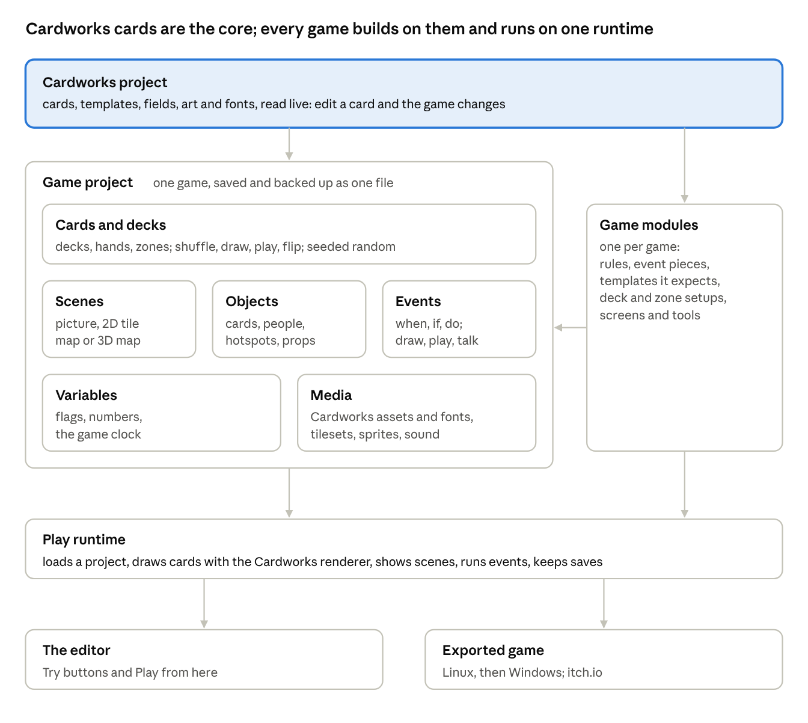
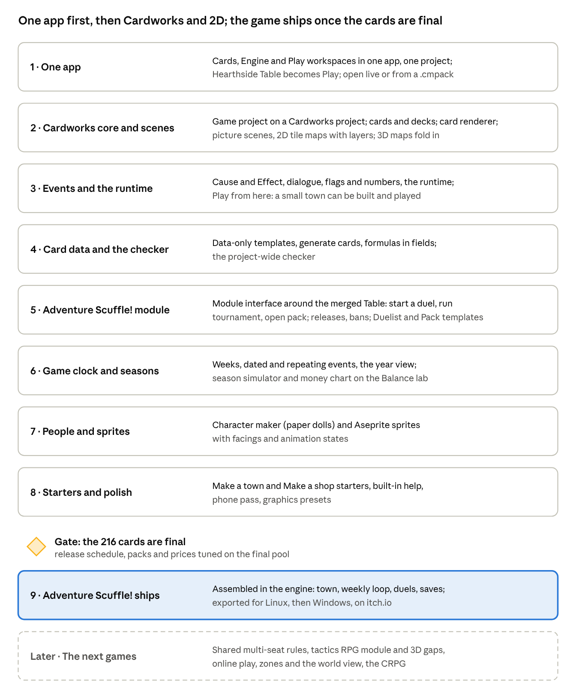

> Copied from the claude.ai doc https://claude.ai/artifact/XWXm8CSvwHBDNRcoMuWd4i on 2026-11-01 (the original is in `originals/engine-plan.docx`). The doc may be newer than this copy.

# Hearthside Engine: the plan

Oct 29, 2026 · @Hanielle Marie Armas

## What the engine is

Hearthside Engine is a general game engine with Cardworks at its core: cards made in Cardworks are the engine's main building block, and the engine adds what turns them into a video game (scenes, objects, events, variables and one runtime). Adventure Scuffle! is the first game made in it, the tactics RPG the second; neither gets editors of its own outside the core.

- **One app for everything.** Cardworks becomes one app with three workspaces on the same project: **Cards** (today's card editor), **Engine** (scenes, events, decks, the game) and **Play** (Hearthside Table, merged in). Switching is one click, and each workspace loads only when it is opened, so the card editor stays as fast as today and Three.js loads only for a 3D map.

- **Cardworks is the core.** A game project sits on a Cardworks project and reads its cards, templates, fields, art and fonts. Edit a card in Cards and the game changes, just as editing a template updates every card today.

- **Two ways into the Engine:**

  - **live:** straight from the Cardworks project that is open, with no export step;

  - **from a .cmpack:** load a game pack into the Engine and work from it; its cards are a fixed copy until you choose Open in Cards to make them editable.

- **A card can be anything a game needs.** The same Cardworks card can be:

  - a card the player and NPCs actually play, as in Adventure Scuffle!;

  - a piece of equipment or a skill (the tactics RPG's 2-faced equipment cards, a skill tree as cards);

  - a way to decide chance: draw from a deck instead of rolling a die;

  - a character, an item, a quest, a reward, shop stock, an event, or plain game data.

- **One engine, many games.** A game is a Cardworks project, a game project and one module. The module brings the rules and a few event pieces; everything else (editing, saving, testing, playing, exporting) is shared.

- **2D first.** Picture scenes and 2D tile maps come before more 3D work. The 3D map editor already built stays as one kind of scene.

- **The editor and the game are the same runtime.** Try buttons, "Play from here" and the Play workspace run exactly what the exported game runs.

- **Cozy Edition:** the basic Cards workspace only, never the whole suite. No Cozy releases unless the owner says so.

- **Unchanged ground rules:** React, TypeScript, Three.js only where 3D is used; offline, no backend; desktop and web; fast on low-end machines; the editor must not confuse (the RPG Maker problem).

- This replaces the build order in "Game engine: platform and feature set", the plan for separate apps, and the loose .cmpack link chosen at the start (.cmpack is now one of the two ways in). That doc stays as the record of the feature decisions, and its 29 October decisions still hold.

## Built so far

Four slices are built: the engine app, its shell and a full 3D map editor. All of it carries over; in the new core it becomes the **3D map** kind of scene plus the first pieces of the shared editor.

| Slice                                 | What it holds                                                                                                                                                                                                                                | Where it fits in the core                                                                                                            | PR                                                                                         |
| ------------------------------------- | -------------------------------------------------------------------------------------------------------------------------------------------------------------------------------------------------------------------------------------------- | ------------------------------------------------------------------------------------------------------------------------------------ | ------------------------------------------------------------------------------------------ |
| 4\. Tile columns, tilesets, viewports | Map v2 (heights in half steps, slopes, water, overhangs); per-face tiles from 16/32/48 px tilesets; one-face hover; Terrain, Paint and Tile modes; single and quad viewports, view cube, ortho, FOV, Game camera; a flat 2D view; perf meter | The 3D map scene kind; tilesets move to Media and are shared with 2D tile maps; the perf meter and viewports are shared editor parts | [\#60](https://github.com/hollywoodenspoon/Card-Marker-Holly/pull/60), open, v0.8.0-beta   |
| 3\. Saving                            | The engine's own IndexedDB, autosave with a Saved badge, Maps dialog, .hsmap files                                                                                                                                                           | Grows into the project file and its backup                                                                                           | [\#59](https://github.com/hollywoodenspoon/Card-Marker-Holly/pull/59), merged, v0.7.0-beta |
| 2\. Editing tools                     | Click to edit, drag as one undo step, shortcuts, the "Open Hearthside Engine" launcher                                                                                                                                                       | Shared editor parts (undo, shortcuts)                                                                                                | \#59                                                                                       |
| 1\. Scaffold                          | engine/index.html, Electron window, Cardworks' themes and component kit, on-demand rendering                                                                                                                                                 | The engine app itself                                                                                                                | \#59                                                                                       |

Cardworks itself is part of the core now: its projects, cards, templates, card renderer, assets, fonts and card data table, and the whole of Hearthside Table, which merges in as the Play workspace: a working, playable card game with its duel screen, animations and deck builder. Also ready to reuse from the rest of the repo: Adventure Scuffle!'s rules engine, bots, deck auto-builder, tournaments, replays and Balance lab (src/adventure/), the .cmpack game pack reader (src/playtest/pack.ts). Engine version: 0.4.0-alpha.1.

## The core

A game project sits on a Cardworks project; Cards and decks are its central part, five more parts surround them, and one runtime plays it in the editor and in the exported game.

the core · six parts in a project, modules plug in, one runtime

Cards come from Cardworks live; a module plugs into the project; the editor and the exported game run the same runtime.

- **Cardworks project:** the cards, templates, fields, art and fonts, read live from the project open in Cards, or from a loaded \`.cmpack\` as a fixed copy. Cards are edited only in Cardworks; there is no second card editor.

- **Game project:** one game's file on top of a Cardworks project. Everything links by id, so renaming never breaks a link. Saved in the engine's own IndexedDB with autosave, backed up and moved as one file (today's .hsmap grows into it); names its modules and their versions.

- **Cards and decks:** the part every game builds on.

  - **Decks** are named piles of Cardworks cards; a game also has hands, discard piles and any other zones, per seat or shared.

  - **Actions:** shuffle, draw, play, flip (2 faces), discard, return, look, all on the game's seeded random numbers, so replays match.

  - **Uses:** cards the player and NPCs play; equipment and skills; chance (draw from a Weather deck instead of a die, with odds shown from what is in the deck); characters, items, quests, rewards, shop stock.

  - **Game data:** Cardworks templates are the game's data tables and cards are the rows. A template can be data-only (no print side) for things like tournaments, so all game data is edited in one place, in Cardworks' card data table, with a generate-cards rule for large pools. Stats and formulas live in fields too.

- **Scenes:** everything the player can be "in", in three kinds that behave the same (objects, events, music, a Try button):

  - **picture scene:** a background with hotspots and character spots, such as the town map or the card shop;

  - **2D tile map:** top-down or side-view; ground, decor and overlay layers plus collision; painted from the shared tilesets with pencil, rectangle, fill, eraser and eyedropper;

  - **3D map:** the editor built in slices 1–4.

- **Objects:** anything placed in a scene: a card (a card on a table, a card as a pickup), a character (paper doll or sprite, or drawn from a character card), a hotspot, a prop, a door, a spawn point. Each has a position, a look, a "shown when" condition and its events.

- **Events (Cause and Effect):** "When… / only if… / do…" sentences from premade pieces, with if/otherwise, choice and random branches, and recipes you save and drop on anything.

  - Card pieces: when a card is drawn or played; only if the player holds a card or the drawn card's field is…; draw, give a card, build a deck, start a duel.

  - Other built-in effects: go to scene, show dialogue (lines, portraits, choices), set a flag, change a number, play a sound, wait. Modules add their own pieces.

- **Variables:** named flags and numbers, and a game clock (turns, days or weeks) with dated and repeating events and a year view.

- **Media:** Cardworks' assets, folders and fonts, plus the engine's tilesets, sprites, paper-doll parts, music and sounds, with where each file is used and a warning before a used file is removed.

- **Play runtime:** loads a project, draws cards with the Cardworks renderer (so a card in the game looks exactly like its print), shows a scene, runs events, keeps variables and saves; pure and repeatable on the seeded random numbers. It grows out of Hearthside Table's engine and screens, and the Play workspace is this runtime.

- **Checker:** reads the whole project with one set of rules (a missing scene or card, a flag checked but never set, missing media) plus each module's rules, every problem a sentence with a link to fix it.

## The editor

One editor for every part, laid out like Cardworks and Canva: the same shell whether you are painting a map, writing a conversation or building a deck, with the cards themselves made in Cardworks.

- **Layout.** Top bar: the workspace switch (Cards, Engine, Play), project name, undo and redo, the Saved badge, Try and Play. Left rail: Cards (the Cardworks project, with Open in Cardworks), Decks, Scenes, Variables, Media, then the module's own tools, each a list with thumbnails. Cards are edited in Cardworks, never in a second card editor. Centre: the open scene or table. Right panel: only what the selected thing can do.

- **Modes follow the scene kind.** The always-visible mode bar keeps the doc's keys:

  - 3D map: Terrain (T), Paint (P), Tile (E), Objects (O), Play (Space), as built.

  - 2D tile map: Paint (P) on layers, Collision (C), Objects (O), Play (Space).

  - Picture scene: Hotspots (H), Objects (O), Play (Space).

- **Undo for everything**, one shared history per project, and autosave with the Saved badge.

- **Try anything on the spot**: play a scene, run a conversation, open 100 sample packs, start a duel. "Play from here" starts the runtime at the open scene in about a second.

- **Starters**: "Make a town", "Make a fight" and "Make a shop" build a working example from the core parts, so a new user plays something in their first minute.

- **Plain words**: events read as sentences, flags have names, the checker says what is wrong in a sentence ("This door doesn't lead anywhere") with a link to fix it.

- **Performance meter** in the editor and in test play (built in slice 4).

- **Built-in help** in the same style as Cardworks' help.

- **Phones and tablets**: side panels become drawers and bottom sheets, as in Cardworks; the map editors stay usable but are aimed at desktop.

## Game modules

A module is the only code a game adds: it plugs into the core through one interface and never reaches around it.

| A module adds                                            | Example from Adventure Scuffle!                                                                                                |
| -------------------------------------------------------- | ------------------------------------------------------------------------------------------------------------------------------ |
| Rules behind the shared rules interface                  | The duel: set up, legal moves, play a move, a seat's view, a guess, result, score, describe a move                             |
| Event pieces (causes, conditions, effects)               | Start a duel, run a tournament, open a pack, if the player owns a card                                                         |
| Cardworks templates it expects, and deck and zone setups | Duelist, Tournament, Pack, Item and Job templates with the fields its rules read; a duel's deck, hand, field and Support zones |
| Screens the runtime can show                             | The duel table, the deck builder, pack opening                                                                                 |
| Tools in the editor's rail                               | Card changes since the last import, release schedule, ban rules, season simulator                                              |
| Checker rules                                            | A tournament on a week that doesn't exist, a pack with no cards                                                                |

- **What every module gets for free:** bots (random, quick, Hard), tournaments, Rush runs, the Balance lab, replays and the replay checker, undo, the debug start, and later online play. They only talk to the rules interface.

- **The shared rules interface** generalises today's Adventure Scuffle! engine from 2 seats to any number, with a seat's view and a guess, so the tactics RPG and later games reuse the bots and the lab. The existing tests keep the duel exactly as it plays now.

- **Shared, never copied:** the same module code runs in the editor, the game, Hearthside Table and the Balance lab.

- **A rules editor** grows from data (boards, pieces, turn structure, effects as data) for simpler games, one game at a time, as in the earlier plan.

## Adventure Scuffle! made in the engine

In Adventure Scuffle! the Cardworks cards are the actual cards the player and the NPCs play, and every other feature is built from core parts plus its module; none of it is a separate editor. The feature details (pool sizes, draw rules, ban timing, ladder tiers, prices) stay as agreed in the feature doc.

| Agreed feature                           | Core parts                                                                                                                                                                     | From the module                                                                                             |
| ---------------------------------------- | ------------------------------------------------------------------------------------------------------------------------------------------------------------------------------ | ----------------------------------------------------------------------------------------------------------- |
| The card game itself                     | The 216 Cardworks cards, read live; decks, hands and zones from Cards and decks                                                                                                | Start a duel: the rules, bots and Hearthside Table's duel screen, showing the cards as Cardworks draws them |
| Card pool, releases, bans                | The Cardworks project's cards, with release and ban fields or data-only release cards                                                                                          | Card changes since the last import, the release schedule and ban rules, a quick lab pass on changes         |
| Collection and deck builder              | The player's collection and saved decks as decks of those cards                                                                                                                | Its screens, reused from Hearthside Table, with the deck rules and the current ban list                     |
| Duelists (about 120)                     | A Duelist template in Cardworks; each duelist is a card (portrait, tier, play style, deck style, lines); the rival and regulars hand-made, the rest from a generate-cards rule | Each duelist's deck built by the deck auto-builder; careers in the season simulator                         |
| Tournaments and the ladder               | A data-only Tournament template; events that announce and enter them                                                                                                           | Run tournament (today's Swiss, top cut, knockout, round robin code)                                         |
| Shop, packs, singles, items, rare buyers | Pack and Item templates as cards; shop hotspots; packs as decks you draw from                                                                                                  | Open pack (a seeded draw from the pack's deck), buy and sell, the pack preview                              |
| Town map and locations                   | A picture scene; each place is a hotspot whose event goes to that location's scene; opening hours as conditions                                                                | —                                                                                                           |
| Town NPCs                                | Character objects in location scenes, drawn from duelist or NPC cards, "shown when" a week or flag condition holds                                                             | —                                                                                                           |
| Dialogue                                 | The Show dialogue effect on a character: lines, portraits, choices that change variables or give cards                                                                         | —                                                                                                           |
| Jobs and activities                      | Job cards (pay, picture, mood effect) and hotspot events that spend a week and change variables                                                                                | —                                                                                                           |
| Calendar and story events                | The game clock (52-week years, school and holiday weeks) with dated and repeating events                                                                                       | Card releases and ban announcements as dated events                                                         |
| Money, parents' mood, rank               | Variables                                                                                                                                                                      | Rank points per placing                                                                                     |
| Character maker                          | Paper dolls as a media kind; a duelist card points at its doll                                                                                                                 | —                                                                                                           |
| Game rules page                          | Project settings: new-game state, variables' rules, difficulty, ending, saves                                                                                                  | Bot levels per tier                                                                                         |
| Tutorial hints                           | Events on "first time" causes                                                                                                                                                  | First Fighting Spirit, first Regroup                                                                        |
| Season simulator, money chart            | —                                                                                                                                                                              | Module tools on the Balance lab's workers                                                                   |

## The tactics RPG made in the engine

The second game uses the same core and adds its own module; the 3D map built in slice 4 becomes its arena.

- **From the core:** 3D map scenes (or 2D tile maps) as arenas and exploration maps; sprite objects with facings; Cause and Effect for map triggers; Cardworks cards for the character pool, equipment, skills, bosses and attack patterns (equipment and skills are 2-faced cards, and the flip is a deck action; a boss's attacks can be a boss deck drawn each turn); variables and saves; picture scenes for the town menu.

- **From its module:**

  - Rules: an action-point budget per piece, a turn order for party and boss, 2-faced equipment cards that flip when used, Damage, Shield, Heal, Enhance, Rooted, Soak, Stack, KILL and forced movement.

  - Map rules: paths, range, line of sight, facings and height, read from the map's tiles and tile rules, never from the renderer.

  - Attack shapes as data (lines, cones, circles, rings), telegraphed on tile tops and resolved in steps.

  - Pieces that cover several tiles, move and face a direction.

  - Event pieces: start a fight, spawn the boss, party member joins.

  - Tools: the boss fight generator (drawing from decks of arenas, bosses, attack patterns and phases), the solver's dodge proof, bot playthroughs through the Balance lab.

- **Stats per game:** each game's own stats and formulas ("HP = Vigor × 12 + Level × 8"), read by a safe parser, stored as data. This is a core part every game can use.

- **Later games** (the real-time-with-pause CRPG) add a fixed-tick clock to the runtime and their own module, on the same parts.

## Look and speed

Three scene looks share one set of tilesets, sprites and pictures, and every one holds 60 fps on a low-end machine.

- **Picture scenes:** a drawn background (the town map, a shop counter) with hotspots and paper-doll or sprite characters in their spots. Drawn on a 2D canvas.

- **2D tile maps:** top-down or side-view, layers drawn from tilesets of 16, 32 or 48 px tiles (Aseprite exports), with pixel-exact zoom. Drawn on a 2D canvas, batched per layer; no WebGL needed.

- **3D maps:** FFT-style textured tile columns, as built: half steps, slopes, water, per-face tiles, overhangs, the 4-way Game camera with tilt and FOV. Three.js, loaded only when a 3D scene opens, so 2D games never load it.

- **Sprites:** Aseprite's sheet export (PNG plus JSON), its tags as animation names, its frame times kept; 4 or 8 facings; in 3D they always face the camera; big pieces cover several tiles.

- **Paper dolls:** greyscale parts coloured by gradient ramps, as agreed for the character maker.

- **Speed targets** (from the 29 October decisions): 60 fps; edits answer in under 50 ms; Play from here in about a second; projects open in a few seconds; zones load in the background. Measured today on a filled 64×64 3D map: 25 draw calls, about 12,500 faces, a 5×5 raise in about 22 ms.

- **Graphics presets** Low (the default target), Medium and High; the 2D look is the last fallback.

## Exported games and online play

An exported game is the Play runtime plus one project file and its modules, packed for Linux first, then Windows, and sold on itch.io first.

- **Runtime:** Electron, tuned for size; a Tauri test later before deciding for good.

- **Stores:** itch.io (Linux AppImage or zip, Windows build, uploaded with butler); Steam later if funds allow. Never Mac. Web and Android to be discussed.

- **Low-end tuning:** packed textures, only nearby zones loaded, rules and bots in a background worker, the graphics presets above.

- **Online play** (for games that want it; not the tactics RPG): host-run WebRTC, join codes or QR codes, the host checks every move, guests see only their own seat's view, bots fill empty seats, a two-window test on one device, and an on/off switch on desktop, which blocks network traffic today.

## Build order

Phase 1 merges everything into one app; phase 2 puts the game project on a Cardworks project and adds cards, decks and 2D scenes; by phase 3 a small town can be built and played, and every later phase adds to the same core.

build order · 8 phases, 1 gate

Phases 1 to 8 work with today's cards; only phase 9 waits for the final 216.

- **Each phase is its own PR** (or stacked, if you say so), with a version bump and the version at the start of its title. Each ends with something you can try in the editor.

- **Slice 4 ([\#60](https://github.com/hollywoodenspoon/Card-Marker-Holly/pull/60)) merges first.** Phase 2 then moves today's maps into a default project, so nothing built is lost.

- **The 3D gaps** (mirror brushes, stamps, tile rules, named areas, objects and sprites in 3D) come with the tactics RPG, or earlier if a phase needs them.

- **Every phase is checked** with type checks, lint and tests (pure parts: the project file, the event runner, data links, the checker), in the browser and in Electron, against the speed targets, with the Cozy build still leaving the engine out.

### Phase 1: one app

- **One shell:** the workspace switch, with Cards, Engine and Play loaded only when opened; one set of menus, settings, themes and help.

- **Hearthside Table moves in as Play,** with nothing lost: the duel screen and animations, deck builder, tournaments, replays, Rush and the Balance lab. Old Table links and saved replays open in Play.

- **The Engine opens on the project open in Cards,** or on a .cmpack loaded into it.

- **Storage:** card projects, game projects and Table data keep their own stores, linked by id, so every existing project and save keeps working.

- **Desktop:** one window with the workspaces, in place of the separate Table and Engine windows.

- **Cozy Edition:** built with the Cards workspace only. No Cozy releases unless the owner says so.

**Also in phase 1 (owner, 29 October):**

- **One UI for all three workspaces:** the same top bar, left rail, right panel, menus, dialogs, buttons and spacing in Cards, Engine and Play, so moving between them feels like one app.

- **UI scaling:** a size setting for the whole interface (text, buttons and panels together), saved per device.

- **View modes for cards and assets,** like a file explorer:

  - large list (today's card list);

  - small list;

  - grid of thumbnails;

  - details, with sortable columns.

The same modes work in the Assets panel, and each panel remembers its mode.

- **Fonts move into Cardworks' Settings,** instead of a separate panel.

- **Card gallery and Proofread are removed for now.** The code stays in the repo so they can come back later.

<!-- -->

- **Resizable side panels:** drag a panel's edge to make it wider or narrower, in every workspace. The cursor changes at the edge. Each width is saved per device, and double-clicking the edge resets it. On touch screens, the edge shows a grab handle you can drag, since there's no hover.

## Open questions

None of these blocks phase 1; the feature doc keeps the full list for each game.

- [ ] What is the engine called, and is each game's name separate from it?

- [ ] Adventure Scuffle!'s town: a menu of picture scenes only, or can the player also walk a 2D map between places?

- [ ] Sprites: 4 facings or 8?

- [ ] Does one Cardworks project hold one game, or can several games share one Cardworks project and its cards?

- [ ] Web and Android exports: yes, later, or never?

- [ ] Online play: is a host who can see everything acceptable for now, and may devices use a public STUN service?

<!-- -->

- [ ] The name: Cardworks Engine, or Hearthside Cardworks with Cards, Engine and Play inside?

- [ ] Keep a light page that opens straight into Play, for playtesting on a phone at the table?

## What changed from the earlier plan

The earlier build order listed a separate editor for each Adventure Scuffle! feature, and the map work grew on its own beside them; this plan builds the shared core first and makes every feature from it.

- **One app for everything:** Cardworks, the Engine and Hearthside Table merge into one app with Cards, Engine and Play workspaces, in place of three separate apps. This is the new phase 1.

- **Two ways in:** the Engine opens live on the open Cardworks project, or on a loaded .cmpack.

- **Cozy Edition:** the basic Cards workspace only, and no Cozy releases unless the owner says so.

<!-- -->

- **Cardworks is the core**, not one data source among others: a game project sits on a Cardworks project and reads it live, and Cards and decks is the central part of the engine. This replaces the loose .cmpack link chosen at the start.

- **A card can be anything:** cards the player and NPCs play, equipment, skills, chance (drawing instead of rolling), characters, items and plain data. Data tables became Cardworks templates, rows became cards, and the media library became Cardworks' assets and fonts plus the engine's own files.

<!-- -->

- **Separate editors become core parts:** the location, NPC, dialogue, activity and calendar editors become scenes, objects, events, variables and the game clock; the duelist, tournament and shop editors become Cardworks templates and cards the module expects.

- **The map editor joins the core** as the 3D map kind of scene, beside picture scenes and 2D tile maps.

- **2D comes first**, ahead of more 3D work (mirror brushes, stamps, tile rules and Objects mode in 3D come with the shared phases instead).

- **The shared rules interface moves later:** the first module can call today's 2-seat engine directly; the multi-seat interface comes before the tactics RPG and online play.

- **Kept as agreed:** every feature decision in "Game engine: platform and feature set", including the 29 October decisions, the speed targets and the export platforms.
