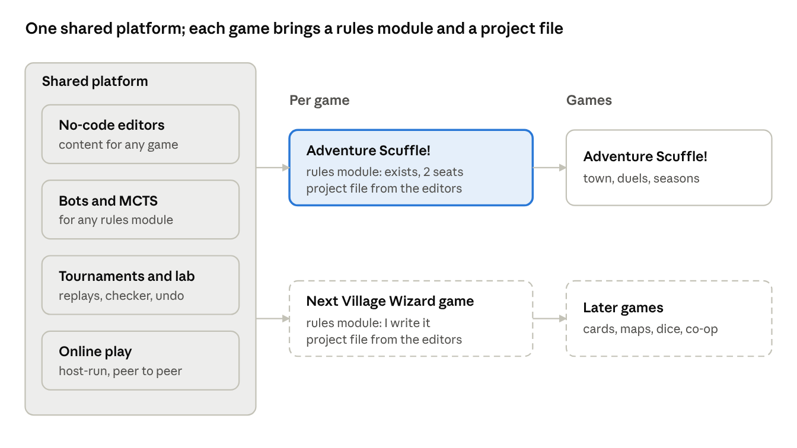
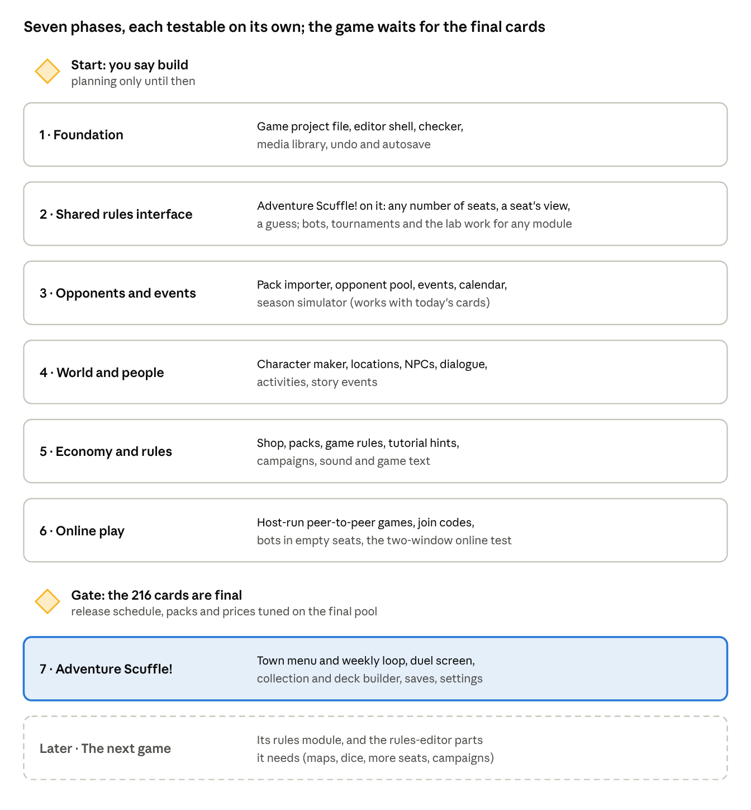

> Copied from the claude.ai doc https://claude.ai/artifact/CgpeWAVsQQHaCL6DyNgw2c on 2026-11-01 (the original is in `originals/game-editor-features.docx`). The doc may be newer than this copy.

# Game engine: platform and feature set

Oct 23, 2026 · @Hanielle Marie Armas

The game engine is Village Wizard's platform for turning its tabletop designs into video games: a shared, no-code editor and player around one rules module per game. Adventure Scuffle! is the first game on it; card games, map and board games, dice games, co-op and story games, solo to 6 players, and online play between two or more devices are all in scope. This doc is the feature set to agree on before anything is built.

## At a glance

the platform · shared parts, one rules module and project file per game

The platform on the left is shared by every game; each game brings only its rules module and its project file.

## Ground rules

Each game is a game project file plus one rules module; the platform around them is shared, so every new game starts with editors, bots, tournaments, balance runs, saves and online play already working.

- **A third app**, beside Cardworks and Hearthside Table, with its own page and desktop window; same stack (React, TypeScript), same themes, works offline, desktop and web.

- **A platform for Village Wizard's games**, as Hearthside Table is a platform for playtesting them. Adventure Scuffle! is the first game, not the only one.

- **Each game turns on the platform parts it needs.** A game without a town skips the town, the schedule and the NPCs and goes straight to matches, a campaign or a scenario list.

- **You make content, I make each game's core rules.** Everything around the rules is no-code; a new game's rules are a module I write behind one shared interface, with a rules editor laid as groundwork for simpler games (see Rules modules).

- **Shared, never copied:** a game's rules module is the same code in the editor, the game, Hearthside Table and the Balance lab, so a rules change shows up everywhere at once.

- **No backend, still.** Online play is peer to peer between players' devices; nothing is stored on a server (see Online play).

- **Never in Cozy Edition.**

- **Planning only for now.** Nothing in this doc is built until you say so.

## Kinds of games

The platform has to hold every kind of design Village Wizard has made, so each kind below names what the engine must support beyond Adventure Scuffle!.

| Kind                    | What the engine must support                                                                                                        |
| ----------------------- | ----------------------------------------------------------------------------------------------------------------------------------- |
| Card games              | Decks, hands, fields, discard and other zones; hidden and face-down cards; card effects as data (as in Adventure Scuffle! today)    |
| Board games with a map  | Grids, hex maps and free-shaped spaces; pieces that move, stack and capture; paths, ranges and line of sight; map editor            |
| Dice and push-your-luck | Dice of any faces and symbols, re-rolls, held dice, odds shown to players; every roll from the seeded random so replays match       |
| Co-op and story games   | Players against the game: a game-controlled side with its own deck or script; scenarios, campaigns, saved progress between sessions |
| Solo                    | One player against the game or a bot; puzzles and scored runs                                                                       |
| 1v1                     | As Adventure Scuffle! today                                                                                                         |
| 3 to 6 players          | Turn order for many seats, teams, free-for-all, players knocked out; hidden information per seat; bots in any seat                  |
| Online                  | Two or more devices in one game, peer to peer (see Online play)                                                                     |

All kinds share one rule: the game state is plain data, every change is a move, and randomness is seeded, so undo, replays, the checker, bots and online play work the same way for every game.

## Rules modules

A game's rules are one module behind a small shared interface; anything that only talks to that interface works for every game.

**The interface** (the Adventure Scuffle! engine already has most of it, for 2 seats)

| Part                        | What it does                                                                                   |
| --------------------------- | ---------------------------------------------------------------------------------------------- |
| Set up                      | A new game from the players, their decks or armies, options and a seed                         |
| Legal moves                 | Every move the seat to act may make now                                                        |
| Play a move                 | The next state; the same move on the same state always gives the same result                   |
| A seat's view               | What one seat may see: other players' hands, face-down cards and the game's own secrets hidden |
| A guess                     | Fills in the hidden parts plausibly, so bots can think without peeking                         |
| Result                      | Winner, ranking or score for any number of seats, or a shared win and loss for co-op           |
| Score a position (optional) | How well a seat is doing, so the strongest bot plays better                                    |
| Describe a move             | The log line and the animation cues for the screen                                             |

**What every module gets for free**

- Bots: random, quick and MCTS (Hard), which use only legal moves, play a move, a seat's view and a guess; difficulty settings and the Bot ladder.

- Tournaments, Rush runs, the Balance lab, replays, the replay checker, undo, the debug start, and online play.

- The table screen from the board setup (zones, seats, pieces), with the same action-by-action playback as Hearthside Table.

**Groundwork for a rules editor** (for simpler games, and for the data parts of complex ones)

- Board and zones: the setups Hearthside Table already uses, extended with grids, hex maps and spaces.

- Pieces and components: cards, tokens, dice and their faces, each with fields you set.

- Turn structure: phases and steps in order, with who acts in each.

- Actions: what a seat may do in a step, with conditions and costs.

- Effects as data: the effects reader from v3.2, grown into a shared library (move, draw, gain, roll, swap, lock, score).

- A module can mix both: the data parts from the editor and the hard parts in code, so the editor grows with each game instead of being built all at once.

**Groundwork in today's engine:** Adventure Scuffle!'s engine assumes 2 seats; moving it to the shared interface (any number of seats, rankings, a seat's view, a guess) is the first step, and its tests keep it honest.

## Online play

Players connect their devices directly (WebRTC), one device hosts, and nothing about the game is stored on a server.

- **Host-run games:** the host's device runs the rules module and sends each guest only its own seat's view, so a guest's app never holds other players' hidden cards. Guests send moves; the host checks each move is legal before playing it.

- **Joining:** the host shows a join code (or a QR code on phones); guests enter it and send a reply code back. That exchange needs no server, only a chat app or the same room.

- **Matching versions:** both sides must run the same rules module and the same game project file; the join step checks this and says what to update.

- **Bots fill empty seats**, so a 4-player game can start with 2 people.

- **Dropped connection:** the host keeps the game; a guest rejoins with the same code, and a bot can play for them meanwhile.

- **Same room or far away:** on the same Wi-Fi it connects directly; across the internet it uses a public STUN service to find a route, which works for most home networks.

- **Desktop app:** it blocks all network traffic today, so online play needs its own on/off switch there, asked the first time.

Two limits, both open questions: the host can see everything, so a host could cheat; and some networks block direct connections and need a relay server (TURN), which is a server even if it never stores anything.

## The second game: a single-player tactics RPG

The second game is a single-player, turn-based tactics RPG, loosely based on Pocket Boss Fight (rules v0.1.5). Its fights are modelled on Final Fantasy XIV boss fights. You lead a party of six against a boss on a bigger map. Fights come first: the story supports them, and the game should be very replayable, with a boss fight generator. A video game doesn't have a physical game's limits, so the scope is bigger than Pocket Boss Fight's.

### What stays from Pocket Boss Fight

- **Equipment is your action set.** Each piece of equipment works as a card with a different action on each of its 2 faces. Using an action flips the card.

- **Turn-based with an action budget**, like the Timer and Time Costs. Movement is at the heart of every turn.

- **Telegraphed boss attacks** are shown on the tiles first and then resolved, so you dodge by moving.

- **The keywords:** Damage, Shield, Heal, Enhance, Rooted, Soak, Stack, KILL and forced movement. The action set itself will be new.

### What changes

- **Single player:** you control all six party members. No online play is needed for this game.

- **Maps:** bigger, and sized to fit each enemy. The boss stands on the map and moves too.

- **The party:** you pick it from a pool of characters, and every character is very different from the others. Party members can't be customised.

- **Your own character:** the one party member you customise.

- **Story:** there is one, but it serves the fights.

- **Boss fight generator:** new fights to replay.

- **Town:** a menu, as in the first game (Adventure Scuffle!'s town). One town or several is still open.

### The look: voxel maps and 2D sprites

Yes, this works. It's the look of Final Fantasy Tactics, Tactics Ogre and Triangle Strategy: a 3D block map with flat, hand-drawn characters standing in it.

- **Voxel arenas:** maps are built from blocks. Each column of the grid is one tile with a height, so the rules still see a grid and the solver still works.

- **2D animated sprites:** party members and bosses are drawn sprites that always face the camera.

  - Each sprite has 4 or 8 facings, so you can see which way a piece faces; that matters for front, side and back bonuses.

  - A boss sprite is big and covers several tiles.

- **Camera:** a tilted view that turns in 90° steps and zooms, plus a top-down view for reading attacks. Telegraphs are drawn on the top faces of the tiles, so they stay readable on uneven ground.

- **How it's built:** Three.js (WebGL), loaded only by the engine app, so Cardworks and Hearthside Table don't get bigger.

  - Blocks are merged into a few meshes, so 64×64 maps run smoothly on phones.

  - Sprites are flat squares drawn from sprite sheets.

- **Rules stay separate:** the rules module only knows tiles, heights and facings, never the renderer. Card games keep the flat 2D table.

**Voxel arena editor (built in).** A map editor inside the game editor, built on the same 3D view the game uses:

- **Brushes:** raise, lower, flatten, paint a block type, fill, erase, and stamp with a brush size.

- **Building aids:** mirror symmetry, a palette of block types (stone, grass, water, lava…) that can carry rules such as "can't stand here" or "hurts", and spawn points for the party and the boss.

- **Undo and redo**, plus **Try this fight**, which drops a party and a boss onto the map at once.

- **Props:** statues, pillars and ruins are made in MagicaVoxel and imported as .vox, then placed on the map. A full sculpting tool for props would be several times the work of the arena editor, so it waits unless importing proves to be too awkward.

**Sprites from Aseprite.** Aseprite's own export (File → Export Sprite Sheet, a PNG plus JSON data) is read directly. Its tags become the animation names, for example walk-front or walk-back, and its frame times are kept.

**Sprite template (proposal).** The engine ships a starter Aseprite file that Village Wizard owns:

- The frame size, with guides for the tile and the foot point.

- The animation tags already named.

- Separate layers for body, hair, outfit and weapon, so your own character's parts swap like the paper doll.

Like Final Fantasy Tactics, only two facings are drawn, front-diagonal and back-diagonal; the engine mirrors them for the other two. Final Fantasy Tactics' own sprites are Square Enix's and can't be used.

### What it asks of the engine

| Game need                                                                | Engine feature                                                                                                                                                 | Reused later by                     |
| ------------------------------------------------------------------------ | -------------------------------------------------------------------------------------------------------------------------------------------------------------- | ----------------------------------- |
| Maps of different sizes for each fight                                   | Grid boards of any size, with tiles, terrain and named zones stored as data                                                                                    | Any board game with a map           |
| The boss on the map, moving                                              | Big pieces that take up several tiles, face a direction, and move by a script or a simple AI                                                                   | Co-op and story games (enemies)     |
| Six party members, each with an action budget                            | An action-point turn economy for each piece, plus a turn order covering party and boss                                                                         | Most tactics games                  |
| Equipment cards with 2 faces that flip when used                         | Components with faces and state; an action can change its own component                                                                                        | Any card with states                |
| Damage, Shield, Heal, Enhance, Rooted and statuses                       | An effects library and status tokens with caps and durations                                                                                                   | Every game                          |
| Movement, Push and Pull, Melee and Ranged reach, positional bonuses      | Paths, forced movement, range and line checks, front, side and back relative to a facing                                                                       | Board games with a map              |
| Telegraphed attacks on a bigger map                                      | Area shapes stored as data (lines, cones, circles, rings, the whole arena with safe tiles), aimed at the boss, a tile or a party member, and resolved in steps | Co-op games                         |
| Soak, Stack, KILL and per-character assignments (the old Roman Numerals) | Per-tile effects, headcount checks ("exactly N here", "at least N"), and marks on chosen party members                                                         | Co-op games                         |
| A pool of distinct characters                                            | A roster: each character's kit of equipment cards and traits stored as data                                                                                    | Any game with characters            |
| Your own character                                                       | The Character maker (paper doll) already planned under Duelists                                                                                                | Every game with a player character  |
| Boss fight generator                                                     | Builds fights from parts (arena, boss, attack patterns, phases, adds) within a difficulty budget, then checks them with the solver                             | Any game with generated content     |
| Town and story                                                           | The Town menu, Dialogue editor and Story events already planned for Adventure Scuffle!                                                                         | Every story game                    |
| Voxel maps                                                               | A 3D board view and a built-in voxel arena editor; props imported from MagicaVoxel .vox                                                                        | Any board game that wants a 3D look |
| 2D animated sprites                                                      | A sprite sheet importer (PNG plus Aseprite JSON) with animation states (idle, walk, act, hit, fall) for each facing                                            | Any game with animated pieces       |
| Tile heights                                                             | Height in movement (climb limit), range and line of sight; falls when pushed or pulled off a ledge (if height changes the rules)                               | Board games with a map              |
| Generated arenas                                                         | The fight generator also builds the voxel arena, sized to the boss                                                                                             | Any game with generated maps        |

### The solver, and keeping generated fights fair

Pocket Boss Fight was balanced with a brute-force Python solver. On the platform, the same checks run against the real rules:

- **Dodge proof:** for every attack and every phase, there is a way for the whole party to stay safe. If there isn't, the report names the attack.

- **Worst and best case:** damage for each party, loadout and attack.

- **Generator check:** every generated fight passes the dodge proof before you can play it, and gets a difficulty rating.

- **Bot playthroughs:** bots play each fight many times with different parties, giving win rates per boss and per party, through the existing Balance Lab.

### Replayability

- Generated fights.

- Different parties picked from the pool.

- Different loadouts for your own character.

- Replays of fights, which the platform already records.

How far each of these goes is listed in the open questions.

## The game project file

One project holds one game's content and names its rules module (and its version), saved on the device like a Cardworks project and backed up or moved as one file; the game reads the same file. The rows below are Adventure Scuffle!'s; another game keeps only the kinds it turns on, and can add a map, scenarios or a campaign.

| Content             | What it holds                                                          | Made in             |
| ------------------- | ---------------------------------------------------------------------- | ------------------- |
| Cards               | The card pool from Cardworks packs, sets, release order, ban lists     | Cards and seasons   |
| Characters          | Paper-doll parts, colour ramps, presets, generation rules              | Character maker     |
| Duelists            | About 120: portrait, tier, play style, deck style, lines, career rules | Duelist pool        |
| Tournaments         | Official ladder, unofficial events, formats, prizes, entry rules       | Tournaments         |
| Calendar            | Weeks and years, when events are announced and run, story moments      | Calendar            |
| Locations           | Town map, scenes, backgrounds, character spots                         | Locations           |
| Town NPCs           | Who stands where, on which weeks, and their role                       | Town NPCs           |
| Dialogue            | Conversations, portraits, choices, what a choice changes               | Dialogue            |
| Jobs and activities | Pay, picture, effect on money and parents' mood                        | Jobs and activities |
| Shop                | Packs, rarities, prices, singles, items, buyers of rares               | Shop                |
| Game rules          | New-game setup, money, mood, rank points, difficulty, tutorial         | Game rules          |
| Media               | Pictures, music and sound effects, shared by all of the above          | Media library       |

Everything links by id, never by name, so renaming a duelist or a location never breaks a tournament or a conversation. A checker reads the whole file (see Testing).

## Platform parts

Each part below is built once, in a general form, and any game turns it on; the sections after this one describe each part through Adventure Scuffle!, the first game to use it.

| Part                    | General form, for any game                                                                                     | Adventure Scuffle! uses it for                |
| ----------------------- | -------------------------------------------------------------------------------------------------------------- | --------------------------------------------- |
| Components and releases | Cards, tiles, pieces or scenarios brought in from Cardworks, released over time, with ban or restriction lists | The 216 cards, seasons, ban lists             |
| Opponents and careers   | A pool of characters with tiers, play styles and records; generated or hand-made                               | About 120 duelists, the rival                 |
| Character maker         | Paper dolls from coloured parts, presets, the player's own character                                           | Every portrait                                |
| Events and competitions | Tournaments, leagues, challenges or scenario runs, with entry rules and prizes                                 | The official ladder, shop events              |
| Calendar                | Time in turns, days or weeks, with dated and repeating events                                                  | Weeks and years, announcements                |
| Locations and NPCs      | A map of places, still scenes, who is where and when                                                           | The town and its people                       |
| Dialogue                | Branching conversations that read and change the game's numbers and flags                                      | Talking to anyone in town                     |
| Activities              | Choices that cost time and change numbers (jobs, training, rest)                                               | The weekly choice                             |
| Economy                 | Currencies, items, shops, packs or loot, buyers and sellers                                                    | Money, packs, rares                           |
| Game rules (meta)       | Starting state, numbers that rise and fall, unlocks, endings, difficulty, tutorial                             | Money, parents' mood, rank                    |
| Campaigns               | A map or list of scenarios with progress saved between them                                                    | Not used (for co-op and story games)          |
| Media, sound and text   | Shared pictures, music, sounds and game text                                                                   | All of the game's art and sound               |
| 3D board view           | Voxel maps with tile heights, a turning camera, and markings drawn on tiles                                    | Not used (the tactics RPG's arenas)           |
| Sprite animator         | Animated 2D sprites with facings and states, imported from sprite sheets                                       | Not used (the tactics RPG's party and bosses) |

## Cards and seasons

The cards come from Cardworks packs; this editor decides when each card reaches the game world and what is banned, following the rules already agreed.

**Pack importer**

- Brings in a Cardworks game pack, shows what is new, changed or gone since the last import, and runs the rules checker and a quick Balance-lab pass on the changes.

- Card art, text and stats stay owned by Cardworks; the editor never edits a card, it only points at it.

**Starting pool and release schedule**

- The 45 First Quest cards plus 15 drawn "random-ish" at the start of each new game, then 6 new cards a season from season 3, up to the full 216.

- Draw rules, each a setting: at most 1 Ace among the 15 extra cards and at most 1 per release; no family card arrives alone; families stay at 6 or fewer; a new mechanic arrives with at least 2 cards that use it.

- A preview runs the draw with any seed, so you can look at 20 sample games' pools side by side.

**Ban lists**

- 2 updates a year, a watch list first, a grace period before a ban starts, unbans after a year.

- Each save follows its own play: the game's season simulation flags cards the duelists over-use, and the ban list is drawn from those flags by your rules (how many cards a step at most, which tiers count).

- Hand-made ban events too, for story moments ("the card everyone hated").

**The world's history:** the card game launched 1.5 years before the player's story starts, so the editor sets which cards and bans already happened before week 1.

## Duelists

About 120 duelists climb the same ladder as the player; you hand-make the rival and 10 to 15 regulars, and the editor generates the rest from rules you set.

**Duelist pool editor**

- Per duelist: name, portrait (a paper doll), home town, tier, play style (the bot level and how it plays), deck style (the family or archetype the deck builder aims for, favourite cards it must include), lines for wins, losses and greetings.

- The pool's make-up, as a setting: locals 15 to 20, other towns 60 to 70, the elite 25, international 10.

- Generation rules for the rest: name lists, tier spread, play styles, deck styles, which paper-doll parts they may use.

**Decks, built by the game**

- Once a year, on a "new season" screen, every duelist's deck is rebuilt from the cards that are out, by the existing auto-builder: a first draft by card values, then swaps tested in fast bot games.

- Lower tiers stop early or pick among the top few cards; low-tier duelists own only part of the pool, as the player does.

**Careers and the rival**

- Every duelist keeps ranking points, results and qualifications; the game plays the whole official ladder each season, including the tournaments the player skips.

- Duelists move up or down a tier with their results, and their collections grow.

- The rival stays level with the player's best result: when the player reaches a new stage of the ladder, so does the rival.

- NPC-against-NPC matches are settled by a quick calculation from skill, deck strength and luck; full duels play only when the player is in them or watches.

**Character maker**

- Every character is a paper doll: greyscale parts (bodies, faces, eyes, brows, mouths, hair, outfits, accessories) on one canvas size and pose, coloured by gradient maps; hue, saturation, brightness and contrast can be adjusted, and only the settings are saved.

- Skin tones: 8 to 12 preset ramps of 3 to 5 colours, from very light to very dark, with warmer shadows; hair and eye ramps the same way.

- Re-roll random people to check the mixes, rule out clashing parts (a hat over a tall hairstyle), and save presets.

- Expressions for dialogue swap the eye and mouth parts.

- The new-game screen uses the same maker for the player's own character, limited to the parts you allow.

## Tournaments and the calendar

The week is the game's unit of time: every week costs the player one choice, and the calendar decides what that week can be.

**Tournament editor**

- Kinds: the official ladder (locals, regionals, nationals, Pro Tour, World Championship), community events and shop-run events.

- Per tournament: tier, the weeks it runs, size, format (the existing Swiss, Swiss with a top cut, knockout, round robin, and groups then knockout), match length (best of 1 or 3), entry fee, prize split in money or packs, or ranking points.

- Entry rules: rank needed, an invitation (Pro Tours and Worlds are invitation only), the qualifying events, a deck rule or a banned-card exception for special events.

- Places per step are settings; nationals takes 32, about the top quarter of the active scene.

- A preview plays the tournament with real duelists, decks and bots, using the existing tournament code, and shows the bracket.

**Calendar and events editor**

- Years of 52 weeks with seasons; which weeks are school, holidays and exam weeks (a setting per week).

- When each tournament is announced (a month or a week ahead) and when it runs; announced events show on the player's calendar at home.

- Dated story moments: a dialogue, a gift, a card release, a ban announcement, a new NPC arriving in town.

- Repeating events, e.g. weekly locals every Saturday, with exceptions.

- A year view shows every event as a strip, so clashes and empty stretches are easy to spot.

## Town

The town is a menu over your illustrated town map; each place opens a still scene with paper-doll characters in it, and clicking a character talks to them.

**Location editor**

- The town map picture and each location's spot on it: home, the card shop, the park, the tournament hall, the job sites, and any you add.

- Per location: background picture, when it is open (weeks, days), what the player can do there (shop, train, work, enter a tournament, rest), music.

- Character spots: drag where people stand in the scene; characters slide in or out as they arrive or leave.

**Town NPC editor**

- Put a character in a location on chosen weeks, or by a rule ("the park on sunny weekends after week 10").

- Their role: shopkeeper, a collector who buys rares, the rival, a hint-giver, a duelist who will play you there.

- Which conversation they start, and how it changes over time.

**Dialogue editor**

- Conversations as cards in a flow: each line has a speaker, a portrait expression and the text, with the player's name filled in.

- Choices branch the flow; a choice can change money, parents' mood, a friendship score, give a card or pack, or set a flag that later conversations and events check.

- Conditions on any line: a flag, a week, a rank, a card owned.

- A Play button runs the conversation right there, with the portraits.

**Job and activity editor**

- Per job or activity: where and when it is offered, pay, the picture or short animation, the effect on parents' mood, and any skill or stat it raises.

- Studying, training against a bot, resting and the allowance are activities too, so every weekly choice is set here.

**Story events:** dated moments from the calendar (a dialogue, a gift, a release, a newcomer) and triggered ones ("after the first regionals win"), both shown on the calendar's year view.

## Economy

Money comes from jobs, the allowance, prizes and selling rares, and goes on packs, singles, items and entry fees; the shop editor sets every number.

**Shop editor**

- Packs of 3 cards: which cards a pack draws from (a set, a release, the whole pool that is out), the chance of a rare, the price, and where it is sold.

- Two rarities: common, and rare, a foil version of a normal card.

- Singles: price rules by card value and rarity, how prices move when a card is banned or over-played, and which shops stock which cards.

- Items: name, picture, price and effect (e.g. a deck box, a study guide, a gift for your parents).

- Buyers of rares: card shops, collectors and other NPC players, each with its own prices and when they buy.

- A pack preview opens 100 sample packs with the current settings and counts what came out.

**Collection and deck builder (in the game)**

- The player's cards as a grid with filters, a deck list beside it, the rule check (deck rules and the current ban list), and several saved decks, in the Yu-Gi-Oh! style already agreed.

- A pack-opening screen, with foils shown as the same art with a shine.

**Balance view:** a chart of money in and money out per week over a simulated year, so prices that make packs too easy or too hard to afford show before anyone plays.

## Game rules

One page of settings decides how a new game starts and how the weekly numbers move; changing a number here changes the whole game.

- **New game:** the starting week, money, cards (the starter deck or the starting pool), the character maker, and the rival's introduction.

- **Money:** the allowance and when it is paid, and caps or debts if any.

- **Parents' mood:** a scale, what raises or lowers it (jobs, studying, tournaments, late nights), and what happens at each level (allowance changes, a week grounded, a gift).

- **Rank:** ranking points per placing in each tier of tournament, points lost to inactivity, and what each rank unlocks (regionals, nationals, invitations).

- **Difficulty:** the duelists' bot levels and Hard's thinking time per tier, and an optional assist mode for new players.

- **Tutorial:** the first duels, with a list of hints that show the first time a thing happens (the first Fighting Spirit, the first Regroup), built from the rulebook's wording.

- **Ending:** when a game ends (a set number of years, winning Worlds, or never), and what the player sees then.

- **Saves:** how many save slots, and autosave each week.

## Sound, text and settings

A shared media library holds every picture, music track and sound, so each editor picks from it instead of uploading again.

- **Media library:** pictures (backgrounds, the town map, items, job scenes), music, and sound effects, with folders and tags like Cardworks assets; it shows where each file is used and warns before a used file is removed.

- **Music:** a track per location, for duels by tournament tier, for menus and the new-season screen; loop points and volume per track.

- **Sounds:** card play, reveal, Fighting Spirit, win, loss, pack opening, menu clicks, each picked from the library.

- **Game text:** menu labels, tutorial hints and system messages in one list, so wording is changed in one place.

- **Player settings (in the game):** music and sound volume, text speed, duel animation speed, controls, and the theme.

Card art and text always come from Cardworks; the media library is only for the game around the cards.

## Testing inside the editor

Every editor has a way to try what you just made, without starting the whole game.

- **Checker:** a list of problems across the whole project, each with a link to fix it: a missing portrait or background, a tournament on a week that doesn't exist, a dialogue choice that leads nowhere, an NPC in a closed location, a pack with no cards, a shop price of 0.

- **Try buttons:** play a conversation, open 100 sample packs, run one tournament with real duelists, start any duel between two duelists or against the player's deck.

- **Season simulator:** plays a whole year in a few seconds, with careers, the ladder, ban flags and money, then reports: who rose and fell, which cards the duelists favoured, the rival's path, and the money chart. Built on the Balance lab's worker pool.

- **Debug start (in the game too):** jump to any week, set money, rank and mood, give any card, and start any duel or event.

- **Undo and history:** undo and redo in every editor, and autosave with the "saved" indicator, as in Cardworks.

For every rules module, not just Adventure Scuffle!:

- **Rules test kit:** thousands of random and bot games checked for broken states (a lost piece, a stuck turn, an illegal move accepted), as Adventure Scuffle!'s checker does today.

- **Online test:** two or more windows on one device join the same game, so online play is tried without a second computer.

## Build order

build order · 5 phases, 2 gates

Each phase ships as its own PR and can be tried on its own; phases 1 to 3 reuse the most and work with today's cards, the Adventure Scuffle! game waits for the final 216, and the next game, the single-player tactics RPG, adds its rules module and only the editor parts it needs (map grids, a moving boss, action points, flipping equipment, attack shapes, the roster and the fight generator), and so does each game after it.

## Open questions

These decide details above; none of them blocks the plan.

- [ ] What is the engine called, and is each game's name separate from it?

- [x] Which Village Wizard game would come second? Answered: a single-player tactics RPG built roughly on Pocket Boss Fight's mechanics (see The second game).

- [ ] Tactics RPG: only boss fights, or smaller fights and adds between bosses as well?

- [ ] Tactics RPG: one town or several?

- [ ] Tactics RPG turn order: the whole party moves and then the boss, or a mixed order by speed?

- [ ] Tactics RPG characters: how many in the pool at the start, and are they built around roles like tank, healer and damage?

- [ ] Tactics RPG customising: what changes on your own character, only its looks or also its equipment cards? Is equipment found or unlocked as loot?

- [ ] Tactics RPG generator: fully new bosses, or remixes of hand-made bosses' parts? Difficulty levels?

- [ ] Tactics RPG losses: does a fallen party member stay out for the rest of the fight, as in Pocket Boss Fight?

- [ ] Tactics RPG world: does it keep Yfera, and do The Chimera and Tideborn Mammoth carry over?

- [ ] Tactics RPG height: does it change the rules (high ground, falls, blocked lines), or is it only for looks, like FFXIV's flat arenas?

- [ ] Tactics RPG sprites: 4 facings or 8? (8 doubles the drawing work.)

- [ ] Tactics RPG camera: turn only in 90° steps, or freely?

- [x] Tactics RPG art tools: answered. Sprites come from Aseprite (its sprite sheet export). Arenas are made in the built-in voxel editor, and props are imported from MagicaVoxel.

- [ ] Online: is a host who can see everything acceptable for now (friends playing together), or do some games need cheat-proof dealing from the start?

- [ ] Online: may players' devices use a public STUN service, and, for networks that block direct connections, is a small relay server (TURN) acceptable, or do those players simply stay local?

- [ ] Does Adventure Scuffle!'s week have school, holidays and exam weeks, or only free choices?

- [ ] Is there a friendship score with NPCs, and does it change anything (gifts, hints, better trades)?

- [ ] How does an Adventure Scuffle! game end: after a set number of years, after winning Worlds, or never?

- [ ] How many locations, town NPCs and hand-made duelists for Adventure Scuffle!'s first version?

- [ ] Which platforms ship first: desktop and web, and Android later (its releases are paused)?

- [ ] Should rare prices follow the season (banned cards drop, popular cards rise), or stay fixed?

## Decisions, 29 October 2026

These update the sections above; where they disagree, this section wins (in particular, true voxels are dropped). Still planning only.

### New ground rules

- **Fast and smooth.** The editor and every exported game hold 60 fps. Edits give feedback in under 50 ms, "Play from here" starts in about a second, projects open in a few seconds, and zones load in the background. A performance meter is built into the editor and test play, and every build phase has speed checks.

- **The editor must not confuse you** (the RPG Maker problem). Start from what you want to make ("Make a town", "Make a fight"), with ready starters. Everything is an object on the canvas, and the right panel shows only what the selected thing can do. Events read as sentences, flags have names, there are no numbered switches. "Play from here", a plain-words checklist ("This door doesn't lead anywhere"), undo for everything, built-in help.

### Look: FFT-style textured blocks

- True voxels and the MagicaVoxel import are dropped. Terrain is textured blocks like Final Fantasy Tactics: heights in steps and half steps, slopes and ramps, water and special tiles, side textures (drawn, or generated from the tile's edges as a draft), and props as 2D sprites facing the camera.

- Camera: 4 diagonal views turned in 90° steps, a tilt between high and low, zoom.

- The same tile map shows in a flat 2D view and in the 3D view; your 2D tiles are the block tops. 2D is also the fallback for very weak machines.

- Art stays in Aseprite (tiles and sprites). RPG Paper Maker is a reference for map-making ideas.

### Editing modes

An always-visible switch at the top of the canvas, with one-key shortcuts; the mode decides what a click does, and the side panels follow it.

| Mode    | What you do                                                                                       | Key   |
| ------- | ------------------------------------------------------------------------------------------------- | ----- |
| Terrain | Raise and lower tiles, half steps, slopes, water, blocked tiles                                   | T     |
| Paint   | Put 2D tiles on block faces (tops, sides or both): brush, fill, eyedropper, replace everywhere    | P     |
| Tile    | Double-click a tile to see what it can do: causes and effects, walkable or not, what stands on it | E     |
| Objects | Place and move characters, props, doors, chests                                                   | O     |
| Play    | Test from where you are looking                                                                   | Space |

### Cause and Effect system

Every interactive thing is a list of causes leading to effects, all picked from premade pieces and read as sentences: "When the player steps on this tile → if Has the key → open the gate, play creak; otherwise → show 'It's locked.'"

- **Causes (when…):** steps on a tile, talks to or uses something, a fight starts, is won or lost, a day or week begins, an item is picked up, a flag changes, a timer runs out.

- **Conditions (only if…), optional:** has an item, a flag is set, a number is at least X, a time, who is in the party.

- **Effects (do…):** show dialogue or a choice, give or take items or money, set a flag, change a number, move or turn someone, start a fight, open a door, go to a zone, play a sound, change a tile, wait.

- **Branches:** if / otherwise, dialogue-choice branches, random branches (on the game's repeatable random numbers); they nest.

- **Recipes:** save any cause and effect ("Locked door with key", "Shop keeper") and drop it on anything.

- **Each game adds pieces:** the card game "start a duel", the tactics RPG "spawn the boss", the CRPG "party member joins".

- The checklist catches broken links (a missing zone, a flag checked but never set).

### Maps and exploration

- **Seamless zones.** The world is made of zones placed on one world grid; touching zones connect automatically, and the next zone loads in the background, so there is no loading screen. Caves and doors link with a cause instead.

- **World view in the editor:** zoom out to see every zone together as one big map, edit across zone borders (a road drawn over a border goes into both zones), move or resize zones; distant zones are drawn simplified.

- **Exploration on the same map as fights** (Triangle Strategy style): tile by tile first, real-time free-roam later, on the same maps and causes.

- Rough size limits, to be measured: a fight arena up to about 32 × 32 tiles; exploration worlds large, since only zones near the player are drawn.

### Stats per game

Each game defines its own stats (for example Vigor, Focus), derived values as formulas ("HP = Vigor × 12 + Level × 8", read by a safe parser, never eval), level curves and skill points. (From the Gemini proposal, together with map triggers and the Canva-style layout; its roadmap and prompts are not used.)

### A future game: real-time-with-pause CRPG

In the vein of Baldur's Gate and Pillars of Eternity, but anchored to tiles like RimWorld: every unit is always on one tile (movement only animates between tiles), speed is time per tile, hitboxes and areas of effect are tile shapes, one unit per tile. It runs on a fixed-tick game clock, so fights stay exactly repeatable for bots, replays and the Balance lab. Order: the card game, then the tactics RPG with exploration, then the CRPG.

A Suikoden-style party JRPG is an example for now; the Village Wizard notes on it will decide whether it becomes a game.

### Exported games

- **Platforms:** Linux first, then Windows. Never Mac. Web and Android to be discussed.

- **Stores:** itch.io first (Linux AppImage or zip and Windows builds, uploaded with butler), Steam later if funds allow.

- **Target: very low-end machines.** Graphics presets Low, Medium and High, with Low as the default target (no real-time shadows or depth blur, simpler lighting, shorter view distance, lower internal resolution) and the 2D view as the last fallback. Small memory footprint, packed textures, only nearby zones loaded; tested on a deliberately weak machine in every phase.

- **Runtime:** Electron (the same Chromium everywhere, the most reliable WebGL on Linux), tuned for size; a Tauri test later before deciding for good (on Linux it uses WebKitGTK, often slower for WebGL).

- **How it stays fast:** WebGL (WebGPU where available) with tiles drawn in batches, rules and bots in a background worker, a fixed-tick clock, texture atlases and zone streaming.
